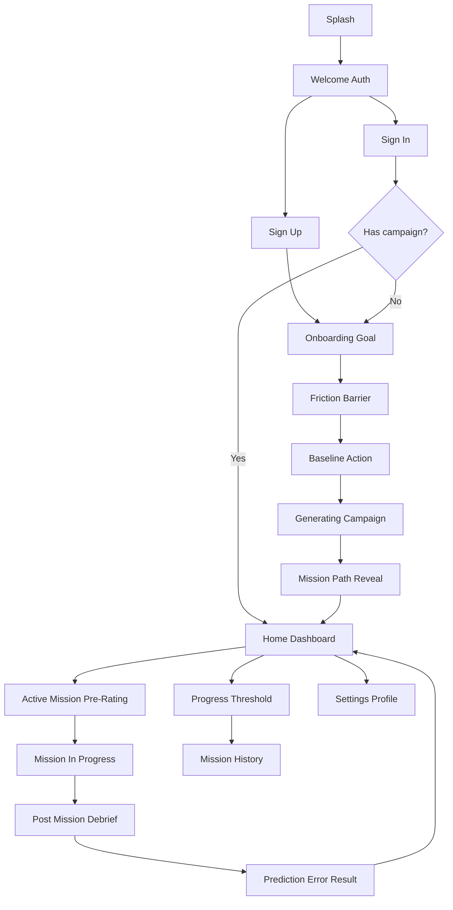
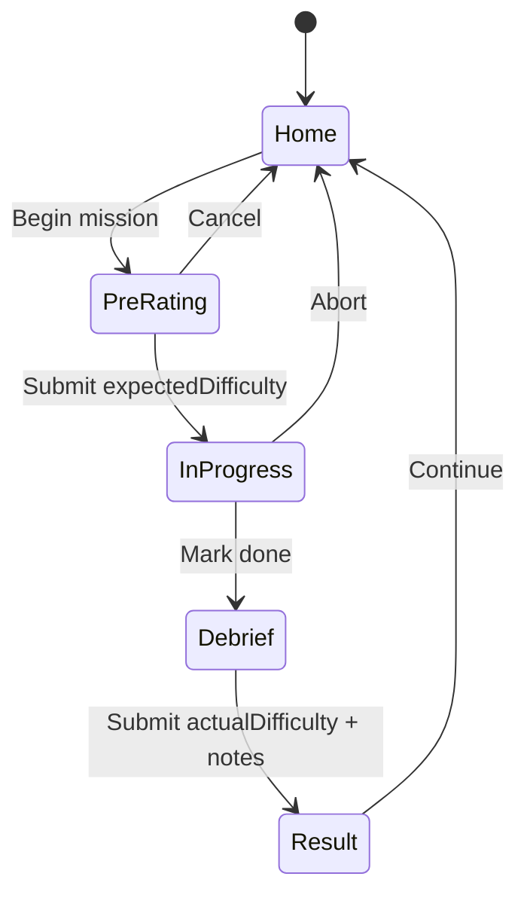

# Threshold — Mock-up Planning Dossier

**Product:** Threshold (action-oriented exposure app)  
**Phase:** Full-screen mock-ups (HTML/Tailwind prototypes)  
**Platform target:** iOS (mock-ups first in browser)  
**Brand:** Void black `#0A0A0A`, charcoal, amber `#F59E0B`, SF Pro / system sans  

---

## 1. Information Architecture

### 1.1 Primary navigation model

- **Pre-auth stack:** Splash → Welcome → Sign In / Sign Up  
- **Onboarding stack (first-run only):** Goal → Friction → Baseline → Generating → Mission Path Reveal → Home  
- **Main app (tab / root):** Home · Progress · Settings  
- **Mission modal stack (from Home):** Active Mission → In Progress → Debrief → Result → back to Home  



### 1.2 Complete screen inventory

| ID | Screen | Flow | Priority |
|----|--------|------|----------|
| S01 | Splash | Entry | P0 |
| S02 | Welcome | Entry | P0 |
| S03 | Sign In | Auth | P0 |
| S04 | Sign Up | Auth | P0 |
| S05 | Onboarding — Goal | Onboarding | P0 |
| S06 | Onboarding — Friction | Onboarding | P0 |
| S07 | Onboarding — Baseline | Onboarding | P0 |
| S08 | Generating Campaign | Onboarding | P0 |
| S09 | Mission Path Reveal | Onboarding | P0 |
| S10 | Home Dashboard | Core | P0 |
| S11 | Active Mission Pre-Rating | Core loop | P0 |
| S12 | Mission In Progress | Core loop | P0 |
| S13 | Post-Mission Debrief | Core loop | P0 |
| S14 | Prediction Error Result | Core loop | P0 |
| S15 | Progress / Threshold Level | Progress | P0 |
| S16 | Mission History | Progress | P1 |
| S17 | Settings / Profile | Account | P1 |
| A01 | Admin — Prompt Rules | Admin optional | P2 |
| A02 | Admin — API Usage | Admin optional | P2 |
| A03 | Admin — Rebuild Campaign | Admin optional | P2 |
| A04 | Admin — Feedback Queue | Admin optional | P2 |

**Mock-up scope for this phase:** All P0 + P1 end-user screens (S01–S17). Admin P2 can be simple placeholder cards if time allows.

---

## 2. Design Tokens (from Brand Guidelines)

### 2.1 Color

| Token | Hex | Usage |
|-------|-----|--------|
| `void` | `#0A0A0A` | App background |
| `charcoal` | `#1A1A1A` | Cards, elevated surfaces |
| `slate` | `#2A2A2A` | Borders, dividers, inputs |
| `muted` | `#6B7280` | Secondary text |
| `fog` | `#9CA3AF` | Tertiary / captions |
| `snow` | `#F9FAFB` | Primary text |
| `amber` | `#F59E0B` | Primary CTA, accents, progress |
| `amber-dim` | `#D97706` | Pressed / secondary accent |
| `success` | `#10B981` | Completed, positive delta |
| `danger` | `#EF4444` | Errors, high anxiety cues sparingly |
| `info` | `#3B82F6` | Neutral system tips |

**Rule:** Dark-first. Amber is the only loud accent. Avoid gamified rainbow badges.

### 2.2 Typography

| Token | Spec | Usage |
|-------|------|--------|
| `display` | 32–40 / Bold | Splash title, big numbers |
| `title` | 24 / Semibold | Screen titles |
| `headline` | 18–20 / Semibold | Card titles, mission titles |
| `body` | 16 / Regular | Primary copy, inputs |
| `caption` | 13–14 / Regular | Meta, timestamps |
| `mono` | 14 / Mono | Scores 0–100, deltas |

Font stack for mock-ups: `-apple-system, BlinkMacSystemFont, "SF Pro Text", "Segoe UI", sans-serif`

### 2.3 Spacing & radius

- Base unit: **4px**  
- Screen padding: **20–24px**  
- Card padding: **16–20px**  
- Stack gap: **12–16px**  
- Radius: **12px** cards, **999px** pills / CTAs, **8px** inputs  
- Shadow: soft elevation `0 8px 24px rgba(0,0,0,0.45)` on charcoal cards  

### 2.4 Core components

- **PrimaryButton** — amber fill, void text, full-width or pill  
- **SecondaryButton** — slate border, snow text  
- **GhostButton** — text-only amber or fog  
- **TextField** — charcoal fill, slate border, snow text  
- **TextArea** — same, multi-line  
- **Slider / DifficultyMeter** — 0–100, amber track  
- **MissionCard** — level badge, title, status chip  
- **ScoreDelta** — expected vs actual with signed difference  
- **ProgressRing / LevelBadge** — threshold score  
- **TabBar** — Home / Progress / Settings  
- **NavHeader** — back + title  
- **EmptyState** — short copy + CTA  
- **LoadingPulse** — amber shimmer for LLM wait  

---

## 3. Screen-by-Screen Specs

### S01 — Splash
- **Purpose:** Brand beat on cold start  
- **Layout:** Centered wordmark “THRESHOLD”, amber underline or threshold icon, void bg  
- **Behavior:** Auto-advance ~1.5s → Welcome or Home if session exists  
- **States:** Default only  

### S02 — Welcome
- **Purpose:** Choose auth path  
- **Layout:** Hero headline (“Cross the threshold.”), short value prop, Primary **Sign Up**, Secondary **Sign In**  
- **Copy angle:** Real-world missions, not streaks  

### S03 — Sign In / S04 — Sign Up
- **Fields:** Email, Password (+ Name on Sign Up)  
- **Actions:** Primary submit, link to switch auth mode, optional “Continue as demo” for prototypes  
- **States:** Default, validation error, loading  

### S05 — Onboarding Goal
- **Prompt:** “What high-stakes ambition are you avoiding?”  
- **Input:** Large TextArea (`ambitionText`)  
- **Examples chips:** Networking with founders / Cold outreach / Public speaking  
- **CTA:** Continue  

### S06 — Onboarding Friction
- **Prompt:** “What’s currently holding you back?”  
- **Input:** TextArea (`frictionPoint`)  
- **Helper:** Name the freeze moment, not the skill gap  

### S07 — Onboarding Baseline
- **Prompt:** “What’s a tiny action you can already do?”  
- **Input:** TextField (`baselineAction`)  
- **CTA:** Generate my mission path  

### S08 — Generating Campaign
- **Purpose:** LLM wait state  
- **UI:** LoadingPulse + rotating status lines (“Breaking goal into levels…”, “Calibrating exposure…”)  
- **No back** during generation (or confirm cancel)  

### S09 — Mission Path Reveal
- **Purpose:** Show ~10 sequential missions before entering Home  
- **UI:** Vertical timeline Level 1→N, each MissionCard collapsed title; Level 1 highlighted  
- **CTA:** Start Level 1 → Home with active mission  

### S10 — Home Dashboard
- **Sections:**  
  1. Greeting + current Threshold score badge  
  2. **Active mission** card (title, level, CTA “Begin mission”)  
  3. Next unlocked preview (locked grey)  
  4. Mini insight: last prediction error if any  
- **TabBar:** Home active  

### S11 — Active Mission Pre-Rating
- **Content:** Mission title, description, target context  
- **Required:** Difficulty slider/input 0–100 (`expectedDifficulty`)  
- **CTA:** “I’m ready — start” enabled only after rating  
- **Note:** Matches Story 2 acceptance criteria  

### S12 — Mission In Progress
- **Purpose:** Lightweight companion while user acts in real world  
- **UI:** Mission summary, timer optional, big CTA “I did it — debrief”, Ghost “Abort / pause”  
- **Tone:** Calm, no streak pressure  

### S13 — Post-Mission Debrief
- **Required:** Actual difficulty 0–100, short reflection notes  
- **CTA:** Submit debrief  
- **Criteria:** Story 3 — both fields required  

### S14 — Prediction Error Result
- **Show:** Expected vs Actual, signed delta, one-line insight (“It was easier than you feared”)  
- **CTA:** Back to Home / View Progress  
- **System side-effect note for later:** unlock next mission / adjust difficulty  

### S15 — Progress / Threshold Level
- **Show:** Current threshold score, capability summary, no streak penalty messaging  
- **CTA:** See full history  

### S16 — Mission History
- **List:** Completed missions with date, expected, actual, delta  
- **Empty:** Encouraging empty state  

### S17 — Settings / Profile
- **Items:** Profile summary, notifications toggle (mission reminder), regenerate campaign (caution), sign out, version  
- **Admin entry:** Hidden/debug gate optional for A01–A04  

### Admin placeholders A01–A04 (P2)
- Simple table/list layouts: prompt template editor, token usage cards, rebuild-by-userID form, feedback status board  

---

## 4. Prototype File Structure (for Code phase)

```text
mockups/
  index.html              # Screen index / clickable map
  css/
    tokens.css            # Design tokens
    components.css
    screens.css
  screens/
    s01-splash.html
    s02-welcome.html
    s03-sign-in.html
    s04-sign-up.html
    s05-goal.html
    s06-friction.html
    s07-baseline.html
    s08-generating.html
    s09-path-reveal.html
    s10-home.html
    s11-pre-rating.html
    s12-in-progress.html
    s13-debrief.html
    s14-result.html
    s15-progress.html
    s16-history.html
    s17-settings.html
  README.md               # How to open & click through
```

**Tech:** Static HTML + Tailwind CDN (or compiled) + shared tokens CSS. Mobile frame width **390px** centered on desktop for iPhone-like review.

---

## 5. Interaction & State Matrix (core loop)



---

## 6. Content & UX principles for mock copy

1. **Exposure, not streaks** — never shame gaps between missions  
2. **Fear vs reality** — always surface prediction error visually  
3. **Fast before/after action** — pre-rating and debrief must feel 10-second flows  
4. **Concrete missions** — sample copy rooted in networking / social friction  
5. **Dark, focused chrome** — one amber CTA per screen when possible  

### Sample campaign (for prototype realism)

**Ambition:** Network with startup founders and build real relationships in the ecosystem
**Friction:** Fear of awkward cold approach
**Baseline:** Comment thoughtfully on one founder’s public post
**Name:** Build a founder network — generated with the path, never sliced out of the ambition

**Levels sketch:**  
1. Like + meaningful comment on a founder post  
2. Send one non-ask DM  
3. Ask one question in a Discord/Slack  
4. Introduce yourself at a meetup to one person  
5. … progressive toward hosting or pitching conversations  

---

## 7. Out of scope for mock-up phase

- Real LLM calls / auth backend  
- Push notification delivery  
- Production React Native / Expo project scaffolding (follows after prototype validation)  
- Full admin CRUD beyond visual placeholders  

---

## 8. Acceptance criteria for this planning phase

- [x] IA covers Screen Flow + user stories S1–S4
- [x] Tokens map to Brand Guidelines colors/type
- [x] Every P0/P1 screen has purpose, layout, key actions, states
- [x] User approves inventory + visual direction
- [x] Code mode implements `mockups/` per structure above

---

## 9. Proposed execution order in Code mode

1. Tokens + component CSS + `index.html` map  
2. Entry + Auth (S01–S04)  
3. Onboarding (S05–S09)  
4. Core loop (S10–S14)  
5. Progress + Settings (S15–S17)  
6. Wire all CTAs for clickable walkthrough  
7. Optional Admin stubs  

---

## 10. Open decisions for user review

1. **Auth depth:** Full email/password fields only, or include “Demo continue” for usability tests?  
2. **Tab bar:** 3 tabs Home / Progress / Settings — confirm, or Home-only with Progress inside?  
3. **Admin screens:** Include P2 stubs in v1 mock-ups or defer?  
4. **Device frame:** 390×844 iPhone frame in HTML — confirm  
5. **Sample domain:** Keep “networking with founders” as the demo campaign across screens?  
